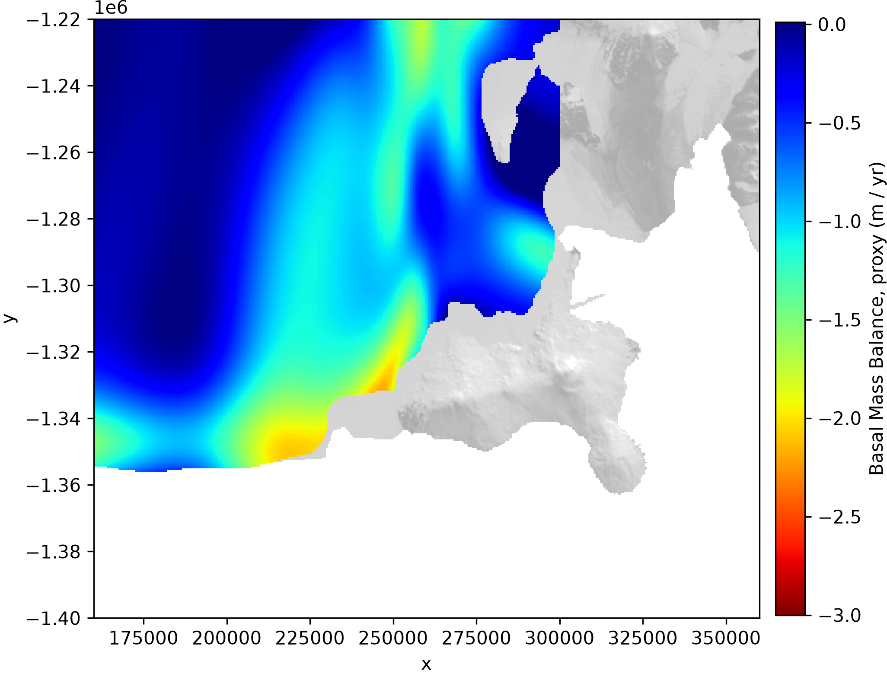
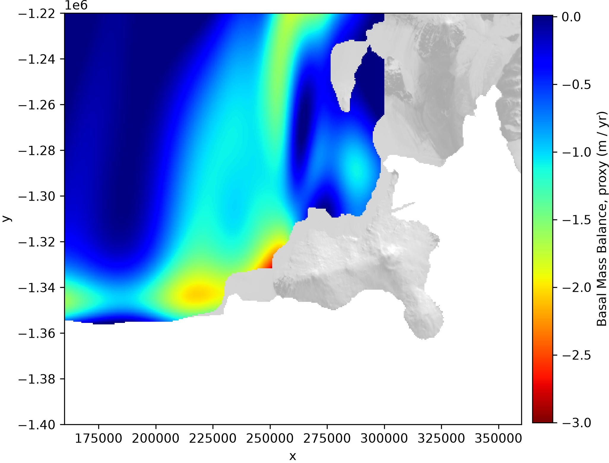
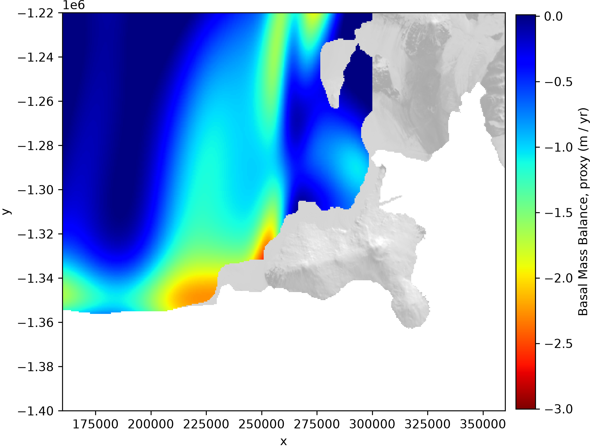
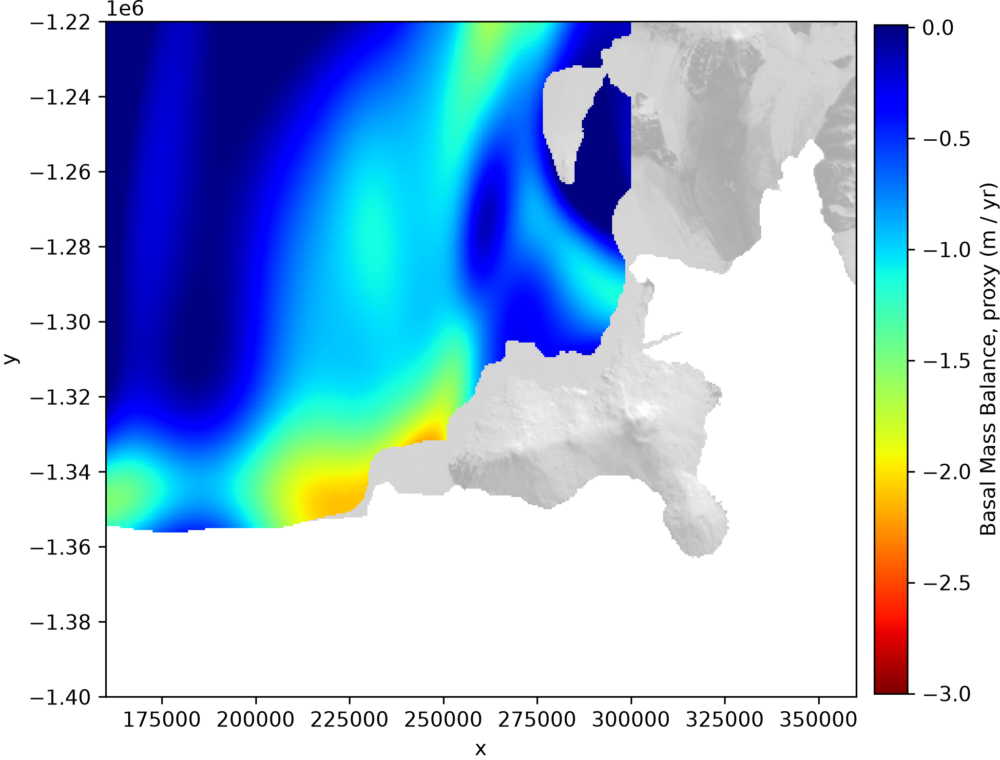
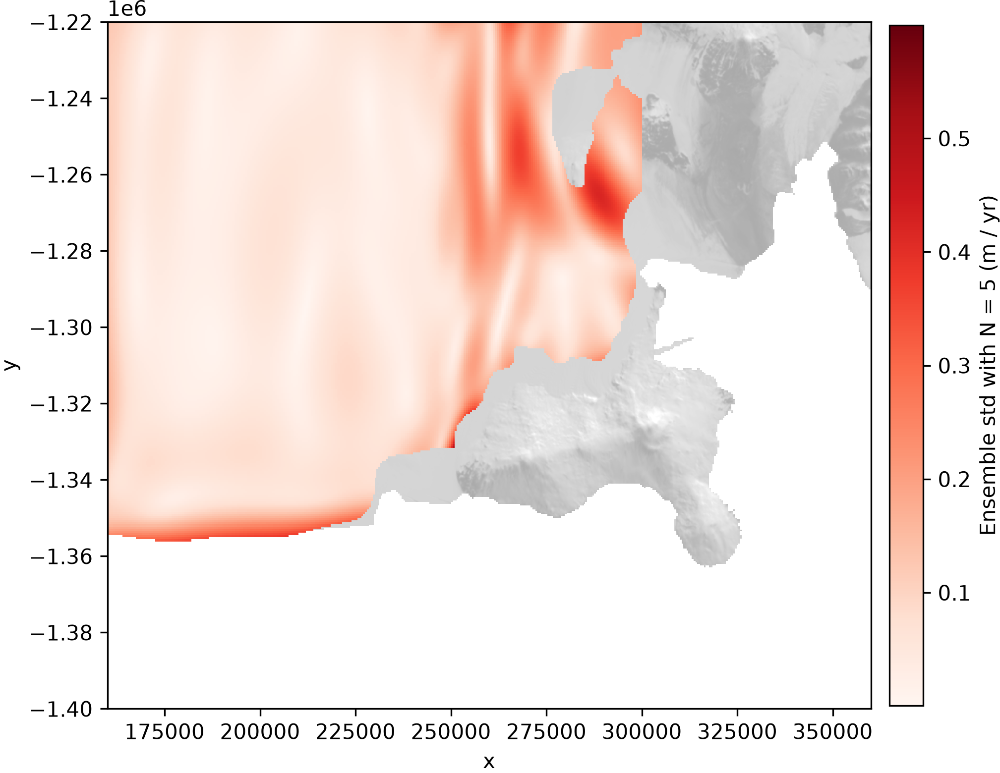

# Basal Melt around Ross Island

Connecting my prior work on "Deep learning ice shelf basal melt via differentiable physics" with work by Craig Stewart (Earth Science NZ), Craig Stevens (Earth Sciences NZ / University of Auckland) et al. using ApRES.

## Notes
- For final product, apply a more careful firn correction. Ths matters particulalry in the lower ice thickness areas.
- Confirm preprocessing and data exclusions. The Eastern flank of the region (lower left corner) appears to still have a lot of noise in some data (presumably unrealistically large discrepancies over small regions).

## Research Plans
- Extending this spatial model (long-term average) to become a **spatio-temporal model** using ITS_LIVE spatiotemporal ice velocities and differencing Bedmap ice thickness measurements with satellite altimetry data.
- Validating FluxNet against ApRES in-situ data
- Training on ApRES data directly (as the final training step) to incorporate in-situ, satellite, and airborne observations.

## Progress
- relying on **model ensembles** rather than a single model.

### Estimates of ensemble members

### STD among ensemble members

