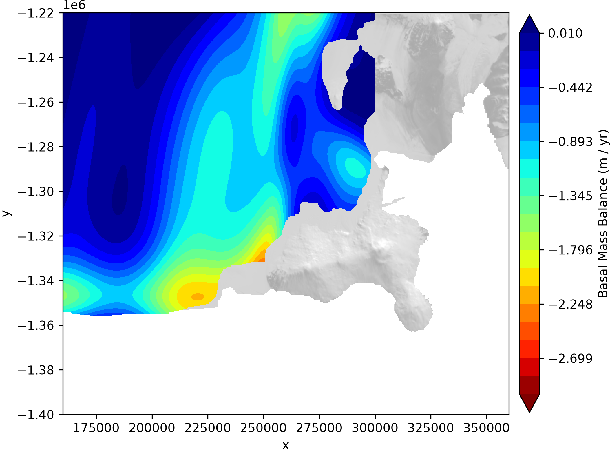

# Basal Melt around Ross Island

Connecting my prior work on "Deep learning ice shelf basal melt via differentiable physics" with work by Craig Stewart (Earth Science NZ), Craig Stevens (Earth Sciences NZ / University of Auckland) et al. using ApRES.

## Notes
- For final product, apply a more careful firn correction. Ths matters particulalry in the lower ice thickness areas.
- Confirm preprocessing and data exclusions. The Eastern flank of the region (lower left corner) appears to still have a lot of noise in some data (presumably unrealistically large discrepancies over small regions).
- It's live has some data issues.

## Research Plans
- Extending this spatial model (long-term average) to become a **spatio-temporal model** using ITS_LIVE spatiotemporal ice velocities and differencing Bedmap ice thickness measurements with satellite altimetry data.
    - ITS_LIVE 2013 data: [ATLAS/ICESat-2 L3B Gridded Antarctic and Arctic Land Ice Height V005](https://nsidc.org/apps/itslive/)
    - Laser altimetry data: [ATLAS/ICESat-2 L3B Gridded Antarctic and Arctic Land Ice Height Change V005 (ATL15)](https://www.earthdata.nasa.gov/data/catalog/nsidc-cprd-atl15-005)
- Validating FluxNet against ApRES in-situ data
    - ApRES data: https://figshare.com/s/1255b7d76ed69e015c3a 
- Training on ApRES data directly (as the final training step) to incorporate in-situ, satellite, and airborne observations.

## Progress
- relying on **model ensembles** rather than a single model.

### Estimates of ensemble members

### STD among ensemble members

# References

Stewart, Craig L., et al. "Basal melting of Ross Ice Shelf from solar heat absorption in an ice-front polynya." Nature Geoscience 12.6 (2019): 435-440.
